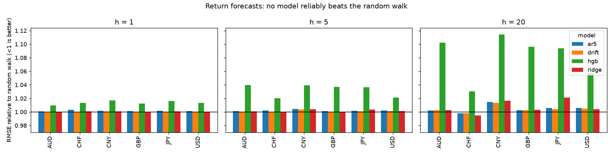
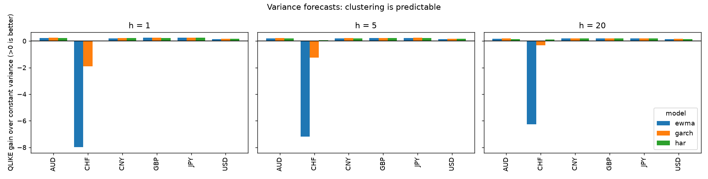

# fxcast

Can you forecast euro exchange rates? This repo asks the question properly and reports the answer
as it came out: **for the rate itself, no; for volatility, yes.**

It is an evaluation harness more than a model zoo. The models are deliberately ordinary. The work
is in the parts of a time-series backtest that are easy to get subtly wrong, and in refusing to
report a "win" that a multiple-testing correction would remove.

Data: ECB daily euro reference rates for USD, GBP, JPY, CHF, CNY and AUD (1999-2026, committed
under `data/` so every number below is reproducible; the ECB permits reuse with attribution).

<!-- run:start -->
Data: ECB daily reference rates, 1999-01-04 to 2026-10-23 (7,183 fixings). Forecasts from 2003-09-10 to 2026-10-22 (528,195 mean forecasts), refit every 63 trading days after 1000 days of training. GARCH fit failures: 0.
<!-- run:end -->

## What was tested

| track | target | benchmark | models |
|---|---|---|---|
| **level** | h-day-ahead log return, h in {1, 5, 20} | **random walk** (forecast zero) | historical drift, AR(5), ridge on 20+ features (incl. other currencies), small gradient-boosted trees |
| **volatility** | average daily variance over the next h days | expanding-sample variance ("it is constant") | EWMA (lambda 0.94), HAR-style regression, GARCH(1,1) |

Results are scored by RMSE relative to the benchmark (levels) and QLIKE loss (variance), with a
**Diebold-Mariano test** of equal accuracy for each comparison.

## Result 1: no model reliably beats the random walk

Relative RMSE against the random walk (1.0000 = same, below 1 = better); `*` = significant after Holm
correction across all 72 comparisons.

<!-- mean-headline:start -->
- 72 model-currency-horizon comparisons against the random walk.
- 6 of 72 have a lower RMSE than the random walk; 29 of 72 are 'significant' at 5% **before** multiplicity correction.
- After Holm correction: **0** significantly better than the random walk, **10** significantly worse.
- Best single result: ridge on CHF at h=20: relative RMSE 0.9949 (adj. p=1.00), i.e. 0.51% lower RMSE.
<!-- mean-headline:end -->



<details><summary>Full table</summary>

<!-- mean-table:start -->
**h = 1 day**

| currency | ar5 | drift | hgb | ridge |
|---|---|---|---|---|
| AUD | 1.0009 | 1.0001 | 1.0098 | 1.0001 |
| CHF | 1.0030 | 0.9999 | 1.0132* | 1.0009 |
| CNY | 1.0015 | 1.0007 | 1.0168* | 1.0010 |
| GBP | 1.0012 | 1.0001 | 1.0122 | 1.0001 |
| JPY | 1.0017 | 1.0002 | 1.0161* | 1.0008 |
| USD | 1.0014 | 1.0002 | 1.0135* | 1.0003 |

**h = 5 days**

| currency | ar5 | drift | hgb | ridge |
|---|---|---|---|---|
| AUD | 1.0015 | 1.0006 | 1.0397* | 1.0007 |
| CHF | 1.0024 | 0.9995 | 1.0202 | 0.9994 |
| CNY | 1.0044 | 1.0037 | 1.0392* | 1.0042 |
| GBP | 1.0014 | 1.0005 | 1.0371* | 1.0004 |
| JPY | 1.0017 | 1.0009 | 1.0364 | 1.0034 |
| USD | 1.0020 | 1.0011 | 1.0214 | 1.0014 |

**h = 20 days**

| currency | ar5 | drift | hgb | ridge |
|---|---|---|---|---|
| AUD | 1.0021 | 1.0027 | 1.1024* | 1.0028 |
| CHF | 0.9979 | 0.9981 | 1.0303 | 0.9949 |
| CNY | 1.0145 | 1.0135 | 1.1140* | 1.0164 |
| GBP | 1.0026 | 1.0024 | 1.0962 | 1.0032 |
| JPY | 1.0058 | 1.0040 | 1.0939* | 1.0213 |
| USD | 1.0057 | 1.0049 | 1.0572 | 1.0042 |
<!-- mean-table:end -->

</details>

Reading it: ridge, AR(5) and drift sit within a fraction of a percent of the random walk, on
either side, which is what noise looks like. The gradient-boosted model is the only one that is
distinguishable from the benchmark, and it is distinguishable as **worse**: a flexible model fitted
to a target with almost no signal learns noise, and the damage grows with the horizon (more
overlapping, fewer effectively independent labels). This is the Meese-Rogoff (1983) result, and it
has survived forty years of attempts to overturn it at short horizons.

### Does it make money anyway?

Sign-of-forecast strategy at h=1, Sharpe after a 1bp cost per unit of position change, spot returns only:

<!-- econ-table:start -->
| currency | ar5 | drift | hgb | ridge |
|---|---|---|---|---|
| AUD | +0.04 | -0.24 | +0.15 | -0.24 |
| CHF | -0.16 | +0.25 | +0.17 | +0.07 |
| CNY | -0.35 | -0.32 | -0.16 | -0.21 |
| GBP | -0.31 | +0.10 | -0.01 | +0.02 |
| JPY | -0.67 | -0.02 | -0.09 | -0.02 |
| USD | -0.33 | -0.13 | +0.06 | -0.07 |
<!-- econ-table:end -->

Treat every positive entry with suspicion: this is 24 strategy-currency pairs examined on one
history, nothing here is tested for significance, spot-only ignores the interest differential that
dominates real FX returns, and the best-looking model (the boosted trees) has the *worst* forecast
accuracy. A strategy can have a positive Sharpe with a bad RMSE for reasons that do not generalise;
this table is a sanity check, not a result.

## Result 2: volatility is predictable

QLIKE gain over the constant-variance benchmark (positive = better), `*` = significant after Holm correction.

<!-- vol-headline:start -->
- 54 comparisons against the expanding-variance benchmark. After Holm correction, **45** are significantly better and 0 significantly worse.
- Significantly better, by model: ewma: 15/18, garch: 15/18, har: 15/18.
<!-- vol-headline:end -->



<details><summary>Full table</summary>

<!-- vol-table:start -->
**h = 1 day**

| currency | ewma | garch | har |
|---|---|---|---|
| AUD | +0.2336* | +0.2397* | +0.2256* |
| CHF | -7.9930 | -1.8915 | +0.0088 |
| CNY | +0.2012* | +0.2167* | +0.2083* |
| GBP | +0.2387* | +0.2435* | +0.2338* |
| JPY | +0.2356* | +0.2494* | +0.2354* |
| USD | +0.1508* | +0.1679* | +0.1566* |

**h = 5 days**

| currency | ewma | garch | har |
|---|---|---|---|
| AUD | +0.2054* | +0.2185* | +0.1990* |
| CHF | -7.2009 | -1.2542 | +0.0515 |
| CNY | +0.1946* | +0.2120* | +0.2043* |
| GBP | +0.2210* | +0.2290* | +0.2163* |
| JPY | +0.2165* | +0.2353* | +0.2221* |
| USD | +0.1517* | +0.1658* | +0.1593* |

**h = 20 days**

| currency | ewma | garch | har |
|---|---|---|---|
| AUD | +0.1614* | +0.1826* | +0.1455* |
| CHF | -6.2766 | -0.3370 | +0.1198 |
| CNY | +0.1830* | +0.2013* | +0.1925* |
| GBP | +0.1957* | +0.2038* | +0.1848* |
| JPY | +0.1825* | +0.2067* | +0.1889* |
| USD | +0.1401* | +0.1545* | +0.1485* |
<!-- vol-table:end -->

</details>

Volatility clustering is one of the most robust facts in finance and it shows up: all three
models beat constant variance for five of the six currencies at every horizon.

**The CHF exception is a single event, and worth understanding.** From 2011 to January 2015 the
Swiss National Bank held EUR/CHF above a floor, so daily moves were tiny and EWMA/GARCH forecasts
decayed towards zero. When the floor was removed on 15 January 2015 the franc moved by double-digit
percentages in a day, and QLIKE (which punishes under-predicted variance severely, by design)
records a loss thousands of times larger than a normal day's. That one episode dominates the CHF
average. With January-February 2015 excluded, all three models beat the benchmark for CHF too (checked at h=5)
(`python scripts/chf_peg_break.py` reproduces this). The fair reading is not "EWMA is fine for CHF"
but "a model that has only seen a pegged regime cannot anticipate its end", which is true of any
statistical model and is why volatility models are paired with stress tests.

## Why you can trust the harness (and what each safeguard prevents)

1. **Purged training labels.** The label of training row *s* is the return from *s* to *s+h*, known only
   at *s+h*. A model fitted at forecast origin *t* may therefore use rows with *s + h <= t* only.
   Training up to *t* uses labels computed from prices after the forecast date, which is leakage
   that perfectly causal features do not protect against. The engine asserts the condition on every
   fit (`backtest._check_purged`), and a test deliberately breaks the purge to prove the assertion fires.
2. **Causal features, proven by test.** Edit the future of a series; no feature at an earlier date may change.
3. **Truncation invariance, end to end.** Forecasts for a date are identical whether the series ends
   shortly afterwards or continues with wildly different values (tested for every mean model and
   for GARCH, whose filter is easy to get wrong).
4. **Hyperparameters are fixed a priori**, never tuned on the evaluation window; ridge picks its
   penalty by time-series cross-validation inside each training window only.
5. **Overlap-aware significance.** h-step forecasts of overlapping returns have autocorrelated errors.
   The DM test uses a Bartlett long-run variance with h-1 lags and the Harvey-Leybourne-Newbold
   small-sample correction; a test simulates the null and checks the rejection rate stays low where
   a naive t-test is liberal. Directional accuracy is subsampled every h days for the same reason.
6. **Multiple testing.** Holm adjustment across every comparison in a table. Without it the
   "significant" count is dominated by chance.
7. **README numbers are generated** from the result CSVs (`fxcast report`), so the text cannot drift from the data.

## Limitations

- Spot rates only, no carry or forward points; the strategy table is a forecast check, not a tradable result.
- ECB reference rates are a single daily fixing, not a tradable price; there is no bid-ask spread.
- The variance target is the realised squared return, an unbiased but very noisy proxy. QLIKE is
  chosen because it is robust to that noise (Patton, 2011), but only differences in it are meaningful.
- Six currencies and one history; a result that depends on one regime (CHF) says so above.
- The models are small by design. This does not show that no model could forecast FX; it shows that
  ordinary ones, evaluated without leakage, do not, which is the useful prior.
- A single data snapshot (`data/ecb_exr.json` records when it was fetched).

## Run it

```bash
pip install -e ".[dev]"
pytest                                   # 23 tests, about a minute
fxcast backtest --jobs 4                 # about 13 minutes on a laptop; writes results/
fxcast report                            # refreshes the tables in this README
fxcast fetch                             # re-download the ECB data (changes the numbers)
docker build -t fxcast . && docker run --rm fxcast backtest --currencies USD --horizons 5
```

Per-forecast predictions (`results/predictions_*.csv.gz`) are regenerated by `backtest` and not committed.

## References

Meese & Rogoff (1983), *Empirical exchange rate models of the seventies*; Diebold & Mariano (1995);
Harvey, Leybourne & Newbold (1997); Campbell & Thompson (2008) for out-of-sample R²; Patton (2011),
*Volatility forecast comparison using imperfect volatility proxies*; Corsi (2009) for HAR; Holm (1979).

Data: European Central Bank, euro foreign exchange reference rates. MIT licence.
